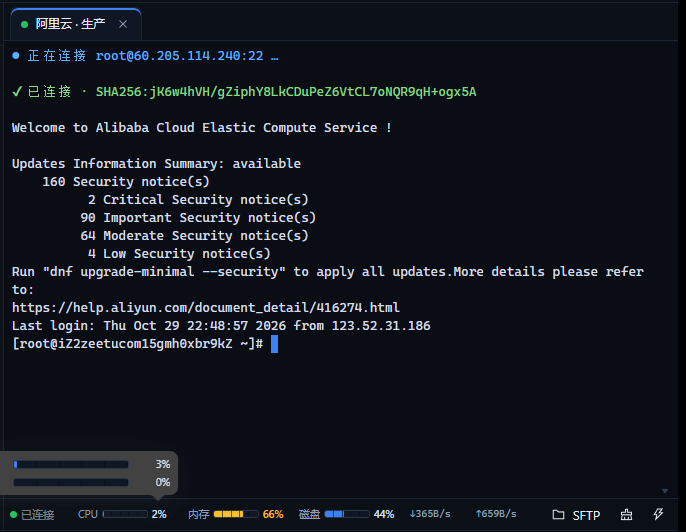
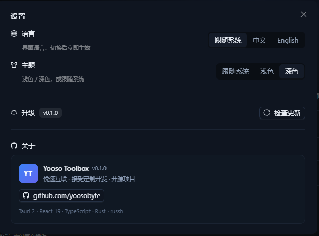
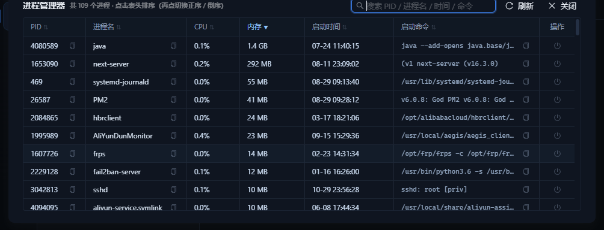
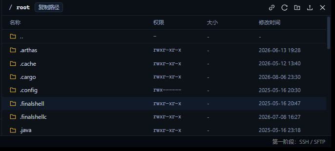
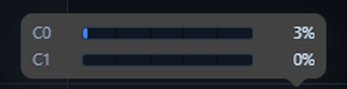
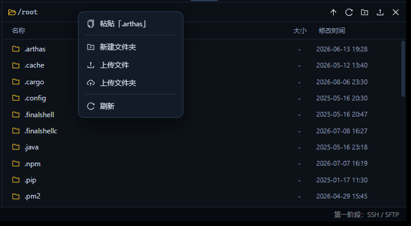
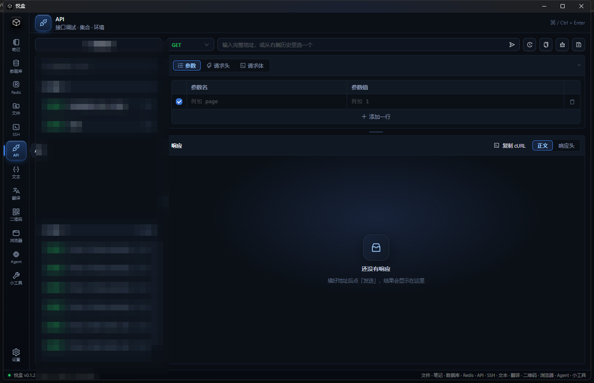

# Yooso Toolbox

一个基于 **Tauri 2 + React + Ant Design** 的桌面工具箱，计划陆续集成 JSON 处理、二维码、数据库（MySQL）、Redis、API 调试、SSH/SFTP 等模块。

**目前可用：SSH 终端 + SFTP 文件管理（FinalShell 风格）、API 调试、文本工具（JSON / 对比）、二维码生成/识别、翻译（必应直连 + 变量命名）、DB 客户端（MySQL：连接 / 库表 / 数据 / SQL）、Redis 客户端（键浏览 / 命令行）。**



---

## 技术栈（全部取当前最新稳定版）

| 层 | 选型 | 版本 |
| --- | --- | --- |
| 桌面框架 | Tauri | 2.12（`tauri` 2.12.5 / `@tauri-apps/cli` 2.12.4） |
| 前端 | React + TypeScript | 19.3.1 / 7.0.2 |
| 构建 | Vite（Rolldown/Oxc） | 8.3.5 |
| UI | Ant Design | 6.6.8 |
| 终端 | xterm.js | 6.0.0 |
| 状态 | Zustand | 5.0.16 |
| SSH | russh（纯 Rust，ring 后端） | 0.65.0 |
| SFTP | russh-sftp | 3.0.1 |
| 二维码 | qrcode（生成）+ jsQR（识别） | 1.5.4 / 1.4.0 |
| DB | mysql_async（tokio 异步） | 0.37.1 |
| Redis | redis-rs（tokio 异步） | 0.27.6 |

> SSH 没有用 `ssh2`/libssh2，也没有用 `openssh` 子进程：`russh` 是纯 Rust 实现，
> 配合 `ring` 加密后端，Windows 上只需要 MSVC 即可编译（无需 cmake / nasm / OpenSSL）。

---

## 已实现功能

### SSH 终端
- 密码认证，失败自动回退到 `keyboard-interactive`（部分服务器只开放该方式）
- 私钥认证（`id_rsa` / `id_ed25519`，支持带口令的私钥）
- 多标签页，标签常驻（切换标签不会中断连接）
- 终端自适应窗口大小，实时同步 `window_change` 到远端
- **复制 / 粘贴**：终端右键菜单；快捷键见下
  - Windows / Linux：`Ctrl+Shift+C` / `Ctrl+Shift+V`，以及 `Ctrl+Insert` / `Shift+Insert`
  - macOS：`⌘C` / `⌘V`（清屏 `⌘K`），欢迎页的快捷键提示会自动切换成 ⌘ 版本
- **右键菜单**：复制、粘贴、全选、清屏、重新连接、开关文件管理
- URL 自动识别，点击链接用系统浏览器打开
- 断线提示 + 一键重连，终端保留最近 8000 行回滚
- 主机密钥 TOFU 校验：首次连接记录指纹，之后变更会**拒绝连接**并给出明确提示

> **关于 `Ctrl+Shift+C`**：这是 WebView2 内置的「审查元素」快捷键，即使通过
> `AreBrowserAcceleratorKeysEnabled(false)` 关掉后，按键仍然在浏览器层被吞掉、到不了页面。
> 应用已经禁用浏览器快捷键（不会再弹出开发者工具），复制请用工具栏按钮、右键菜单或 `Ctrl+Insert`。

### 设置（左下角齿轮）

| 项 | 说明 |
| --- | --- |
| **语言** | 跟随系统 / 中文 / English，立即生效并记住选择 |
| **主题** | 跟随系统 / 浅色 / 深色，界面、弹窗、终端配色一起切换 |
| **升级** | 读取 `https://qnres.yoosobyte.com/yooso-toolbox/version.txt`：**第一行版本号，第二行安装包直链**；有新版显示「下载安装包」按钮 |
| **关于** | 悦速互联 · 接受定制开发 · <https://www.github.com/yoosobyte/> · 官网 <https://www.yoosobyte.com> |
| **底部状态栏** | 开关控制最底部那条「版本 / 阶段」信息条的显示与隐藏 |



**i18n 覆盖范围**：`src/i18n.ts` 一套中英字典（737 个 key，两边 key 完全对齐），
界面所有文案都走 `t("key")`——左侧导航、模块页、会话列表与表单、终端工具栏与右键菜单、
状态栏指标、SFTP 面板（含全部提示与对话框）、进程管理器、API / 二维码 / 翻译模块、设置面板。
后端返回的错误信息目前仍是中文（会出现在错误提示里），后续可以把错误码也纳入 i18n。

> 版本 txt 示例：
> ```
> 0.2.0
> https://qnres.yoosobyte.com/yooso-toolbox/Yooso-Toolbox_0.2.0_x64-setup.exe
> ```

主题实现：`styles.css` 里所有颜色都收拢成 CSS 变量（`--bg / --surface / --border / --text / --accent …`），
`<html data-theme="light">` 只覆盖变量值；antd 在深色/默认算法间切换，xterm 用两套终端配色。

### 会话管理
- 会话增删改查、搜索、复制、标识色
- **全应用只有一个「新建会话」入口**（右上角；列表为空时列表内提示一次）
- 会话卡片支持右键菜单：连接、置顶、编辑、复制、删除
- 卡片上可一键复制 IP
- **列表顺序固定**：置顶优先，其次按创建时间；点击会话不会让列表重排
- 「测试连接」按钮：只做握手 + 认证，验证主机/端口/凭据是否可用
- 同一会话重复点开时聚焦已有标签页
- 配置持久化到应用配置目录

### 状态栏监控
终端底部状态条实时显示远端指标（每 3 秒采样一次，单次 exec 完成），每项都带一条**分段进度条**
（20% 一格，带首尾边框）：

- **CPU**：总占用百分比 + 分段条，鼠标悬停看每个逻辑核心的独立条形图
- **内存**：已用百分比 + 分段条，悬停看大条与 `已用 / 总量 · 百分比`
- **磁盘**：根分区 `/` 使用率 + 分段条，悬停看容量
- **网速**：网卡实时收发速率（自动切换 B/s、KB/s、MB/s），不含 `lo`
- 数值列定宽左对齐、等宽数字，数值变化时前面的文字不会跳动

### 进程管理器
状态栏 CPU 前面的图表图标，点开是一个进程列表弹窗（一次 `ps` 采样）：

- 列：`PID / 进程名 / CPU / 内存 / 启动时间 / 启动命令 / 操作`
- PID、进程名、启动命令后都可一键复制；操作列可结束进程（确认后发 `SIGTERM`，并自动刷新列表）
- 顶部搜索框做**前端模糊过滤**（PID / 进程名 / 启动时间 / 启动命令 拼串后包含匹配），不重新连服务器
- **默认按内存倒序**；点任意表头改为按该列排序，再点同一列切换正序 / 倒序
- 一次只能按一列排序，切换列时自动清掉上一列的排序
- 最多展示 500 个进程（按内存倒序截断），右上角可手动刷新



采样命令只读 `/proc`、`df`、`/proc/net/dev`，不安装任何远端 agent。

### SFTP 文件管理
- 与终端共用同一条 SSH 连接（不额外占端口、不重复认证）
- **面板停靠在终端下方**，拖动中间分隔条可调整高度（高度会被记住）
- **路径与操作按钮合并为一行**：`路径 · 跟随 · 刷新 · 新建文件夹 · 上传（文件 / 文件夹）· 关闭`
- **路径是面包屑**：`/ root www`，点任意一段直接跳到该目录；紧挨路径右侧是「复制路径」按钮
- **跟随终端目录**（默认开启）：路径条上的 🔗 按钮，开启时 SFTP 会自动切到远端 shell 的当前目录
  （直接读 `/proc/<shell>/cwd`，不往终端里发送任何命令、不污染命令历史）；点一下变成断开图标即停止跟随
- **`..` 行**：列表最上方固定一行「📁 ..」，双击回到上一级
- 列表按 `名称 / 权限 / 大小 / 修改时间` 四列展示，全部左对齐（表头吸顶，滚动时仍与数据对齐）
- **拖拽上传**：把文件或整个文件夹拖进列表即可；文件夹会先在本地打包成 `tar.gz`、
  上传后在远端解压（远端没有 `tar` 时自动回退为逐文件上传）
- **右键菜单**（全应用屏蔽了浏览器默认右键，均为自绘菜单）
  - 文件 / 文件夹：下载、复制、重命名、删除
  - 空白处：粘贴、新建文件夹、上传文件、上传文件夹、刷新
- **复制粘贴**：优先调用远端 `cp -a`（瞬间完成），不可用时回退为 SFTP 逐文件复制；
  在同一目录粘贴会自动生成「xxx - 副本」
- 双击目录进入、双击文件下载；上传 / 下载带实时进度与传输列表
- 目录优先 + 名称排序，`名称 / 大小 / 修改时间` 三列
- 初始化失败（例如服务器拒绝 sftp 通道）时在面板内常驻错误原因，并提供「重试」

底部 SFTP 面板（真实 OpenSSH 服务器，路径 `/root`；面板高度可拖动调整）：



状态栏监控与单核 CPU 悬停详情：



空白处右键菜单：



---

## 快速开始

```bash
# 1. 安装依赖
npm install

# 2. 开发模式（自动拉起 Vite + Tauri 窗口）
npm run tauri dev

# 3. 生产构建（生成 NSIS 安装包）
npm run tauri build
```

### 应用图标

- `app-icon.png` 是 1024×1024 母图（内容满画布）。
- `npm run icons:platform` 会生成平台适配图标：
  - macOS：内容缩到 **824/1024（约 80.5%）** 并居中留透明边，写入 `icon.icns`，避免 Dock 里比其他 App 显大。
  - Windows：内容保持 **942/1024（约 92%）**，生成多尺寸 `icon.ico` 和 PNG/Square 资源。
- 图标更新后需要重新构建并完全重启应用；macOS 若 Dock 仍缓存旧图标，可执行 `killall Dock`。

构建产物：

- 可执行文件：`src-tauri/target/release/yooso-toolbox.exe`（实测 5.31 MB）
- 安装包：`src-tauri/target/release/bundle/nsis/Yooso Toolbox_0.1.0_x64-setup.exe`（实测 2.05 MB）

单独校验前端：

```bash
npm run typecheck   # tsc --noEmit
npm run build       # tsc + vite build
```

单独校验后端：

```bash
cd src-tauri
cargo check
```

### 已验证的内容

后端带一个真实网络的端到端冒烟测试（默认 `#[ignore]`，不会在普通 `cargo test` 中执行）：

```powershell
cd src-tauri
$env:TEST_SSH_HOST='demo.wftpserver.com'
$env:TEST_SSH_PORT='2222'
$env:TEST_SSH_USER='demo'
$env:TEST_SSH_PASSWORD='demo'
$env:TEST_SSH_SFTP_ONLY='1'          # 该演示服务器没有 shell
$env:TEST_SSH_REMOTE_DIR='/upload'
$env:TEST_SSH_DOWNLOAD_DIR='/download'
$env:TEST_SSH_SKIP_ROUNDTRIP='1'     # 演示账号上传后不允许读回
cargo test --lib ssh_sftp_smoke -- --ignored --nocapture
```

对 `demo.wftpserver.com` 的实测结果：

| 环节 | 结果 |
| --- | --- |
| TCP + 密钥交换 + 主机指纹 | ✅ `SHA256:8rQmaZoj…` |
| 密码认证 | ✅ `method=password` |
| 同一连接上打开 sftp 子系统 | ✅ |
| `canonicalize` / `read_dir` | ✅ |
| 上传 30 B 文件 | ✅ |
| 下载 664,950 B 文件 | ✅ 大小校验一致（跨多个 64 KiB 分块） |
| 传输进度事件 | ✅ 收到 |

另外在一台真实的阿里云 OpenSSH_8.0 服务器（CentOS/Alinux 内核 5.10）上验证通过：

| 环节 | 结果 |
| --- | --- |
| 密码认证 + 主机指纹记录 | ✅ |
| 真实 bash 交互（粘贴命令、回显、提示符、PTY 尺寸同步） | ✅ `Linux 5.10.134-18.al8.x86_64`、`df -h /`、`free -h` 输出正常 |
| 同一连接上的 SFTP 列目录 | ✅ `/root` 28 项，含目录/大小/修改时间 |
| 目录上传（本地 tar.gz + 远端解压） | ✅ 子目录与文件完整还原 |
| 远端复制（`cp -a`） | ✅ 同目录粘贴生成「- 副本」 |
| 界面层渲染（1024×640 最小窗口） | ✅ 终端光标始终在可视区内，SFTP 停靠在下方 |

> 说明：`demo.wftpserver.com` 只提供 SFTP、没有真实 shell，所以在那台机器上「命令回显」断言被跳过；
> 该链路随后在一台真实的 OpenSSH 服务器上补测通过（见上表）。自测时把
> `TEST_SSH_HOST` / `TEST_SSH_USER` / `TEST_SSH_PASSWORD` 换成你自己的服务器即可。

### 完整测试报告

- 后端：`cargo test -- --include-ignored` 覆盖认证、shell、跟随目录、监控采样、进程列表、结束进程、
  SFTP 增删改查（含 tar.gz 目录上传与 `cp -a` 复制）
- 界面：21 张逐步截图，覆盖连接、命令执行、SFTP 导航/跟随/复制路径/新建/重命名/删除确认、
  进程管理器搜索排序

详见 [docs/test-report.md](docs/test-report.md)。逐条 UI 测试截图保留在本地 `docs/uitest/`（体积大，不入库，`.gitignore` 已忽略）。

### 环境要求

- Node.js ≥ 20.19（本项目在 24.22 下开发）
- Rust stable ≥ 1.89（`russh 0.65` 的 MSRV；本项目在 1.99 下开发）+ MSVC 工具链
- WebView2 Runtime（Win10/11 一般已内置）

> **PowerShell 提示**：如果 `npm` 报「无法加载文件 npm.ps1，因为在此系统上禁止运行脚本」，
> 改用 `npm.cmd`，或执行 `Set-ExecutionPolicy -Scope CurrentUser RemoteSigned`。

---

## 目录结构

```
yooso_toolbox/
├─ src/                         # 前端
│  ├─ App.tsx                   # 外壳：左侧模块栏 + 状态栏
│  ├─ main.tsx                  # 入口（ConfigProvider + antd App）
│  ├─ theme.ts                  # 深色主题 token + xterm 配色
│  ├─ api.ts                    # 所有 Tauri 命令的类型化封装
│  ├─ save.ts                   # 前端生成文件的保存（Tauri 命令 / 浏览器兜底）
│  ├─ base64.ts                 # 终端字节流编解码
│  ├─ types.ts / utils.ts
│  ├─ stores/
│  │  ├─ sessionStore.ts        # 会话列表
│  │  ├─ dbStore.ts             # DB 连接列表
│  │  ├─ redisStore.ts          # Redis 连接列表
│  │  └─ workspaceStore.ts      # 终端标签页
│  └─ modules/
│     ├─ Placeholder.tsx        # 规划中模块的占位页
│     ├─ api/
│     │  ├─ ApiModule.tsx       # 请求构建 / 响应 / 历史
│     │  └─ KeyValueEditor.tsx  # 参数、请求头表格
│     ├─ qrcode/
│     │  ├─ QrModule.tsx        # 生成 / 识别容器
│     │  ├─ QrGeneratePanel.tsx # 生成、Logo、导出
│     │  ├─ QrScanPanel.tsx     # 本地图片识别
│     │  └─ qrRender.ts         # 矩阵 → SVG / Canvas
│     ├─ text/
│     │  ├─ TextModule.tsx      # JSON / 对比 容器
│     │  ├─ JsonTool.tsx        # 格式化 / 压缩 / 树形折叠
│     │  ├─ JsonTree.tsx        # JSON 树渲染
│     │  ├─ TextDiff.tsx        # 实时双栏对比（差异高亮）
│     │  └─ diff.ts             # LCS 行级 diff
│     ├─ db/
│     │  ├─ DbModule.tsx        # 连接 + 库表树 / 数据 / SQL
│     │  ├─ DbForm.tsx          # 连接表单（类型仅 MySQL）
│     │  ├─ DbTree.tsx          # 连接 / 数据库 / 表 / 视图树
│     │  ├─ DbTableTab.tsx      # 表 tab：数据 / 结构 / 索引 / 设置 / DDL
│     │  ├─ DbDataView.tsx      # 表数据分页
│     │  ├─ DbStructureView.tsx # 表结构编辑（内联修改 / DDL）
│     │  ├─ DbDdlView.tsx       # 表 DDL 编辑
│     │  ├─ DbIndexView.tsx     # 表索引编辑
│     │  ├─ DbSettingsView.tsx  # 表设置（名称/注释/引擎/自增）
│     │  ├─ DbNewTableModal.tsx # 新建表
│     │  ├─ DbNewQueryModal.tsx # 新建查询
│     │  ├─ DbCloneTableModal.tsx # 复制表结构/数据
│     │  ├─ queries.ts          # 本地保存查询（localStorage）
│     │  ├─ ddl.ts              # ALTER TABLE 语句构建
│     │  ├─ DbSqlView.tsx       # SQL 编辑器 + 结果
│     │  ├─ DbResultGrid.tsx
│     │  └─ api.ts
│     ├─ redis/
│     │  ├─ RedisModule.tsx     # 连接 + 键浏览 / 命令行
│     │  ├─ RedisForm.tsx       # 连接表单
│     │  ├─ RedisConnectionList.tsx
│     │  ├─ RedisBrowser.tsx    # SCAN 键列表 + 值查看/编辑
│     │  ├─ RedisConsole.tsx    # 任意命令
│     │  └─ api.ts
│     ├─ translate/
│     │  ├─ TranslateModule.tsx # 快速 / 网页版容器
│     │  ├─ QuickTranslate.tsx  # 直连接口翻译 + 变量命名
│     │  ├─ api.ts              # translate_text 调用封装
│     │  └─ identifier.ts       # 标识符拆分与五种命名风格
│     └─ ssh/
│        ├─ SshModule.tsx       # 模块布局
│        ├─ SessionList.tsx     # 左侧会话列表
│        ├─ SessionForm.tsx     # 新建 / 编辑会话
│        ├─ TerminalTabs.tsx    # 标签页 + SFTP 挂载
│        ├─ TerminalView.tsx    # xterm 实例与连接生命周期
│        ├─ SftpPanel.tsx       # 文件浏览器与传输
│        └─ status.ts           # 连接状态文案/配色
└─ src-tauri/                   # 后端（按功能分目录）
   ├─ src/
   │  ├─ lib.rs                 # Builder、AppState、命令注册
   │  ├─ main.rs                # 桌面入口
   │  ├─ api/
   │  │  ├─ mod.rs              # HTTP 请求命令
   │  │  └─ http.rs             # API 调试请求执行
   │  ├─ core/
   │  │  ├─ mod.rs
   │  │  ├─ models.rs           # 前后端共享数据结构
   │  │  └─ store.rs            # sessions / redis / db / known_hosts 配置
   │  ├─ database/
   │  │  ├─ mod.rs
   │  │  └─ client.rs           # MySQL 连接 / 库表 / 表数据 / SQL / DDL
   │  ├─ redis/
   │  │  ├─ mod.rs
   │  │  └─ client.rs           # Redis 连接 / SCAN / 值 / 编辑 / 命令
   │  ├─ ssh/
   │  │  ├─ mod.rs
   │  │  ├─ client.rs           # russh 连接、认证、终端读写 actor
   │  │  ├─ commands.rs         # 会话 / SSH / SFTP 命令
   │  │  └─ sftp.rs             # 目录/增删改/传输实现
   │  ├─ translate/
   │  │  └─ mod.rs              # 必应翻译接口直连 + 命令
   │  ├─ files/
   │  │  └─ mod.rs              # 本地文件保存命令
   │  └─ update/
   │     └─ mod.rs              # 版本检查与命令
   ├─ capabilities/default.json # 权限：core / dialog / opener / clipboard-manager
   └─ tauri.conf.json
```

### 数据流要点

- **终端输出**：Rust 侧 `Channel::wait()` 读到字节 → base64 → `Channel<SshEvent>` → 前端 `term.write(Uint8Array)`。
  用 base64 而不是字符串，是为了避免 UTF-8 被切分到两个包时出现乱码。
- **终端输入**：`onData` 累积 8ms 再批量发送，减少 IPC 次数。
- **读写分离**：`channel.split()` 后，读任务与写任务各自独立，互不阻塞。
- **SFTP**：复用 `Handle<ClientHandler>` 再开一条 channel 跑 `sftp` subsystem，`OnceCell` 懒加载。

---

## 数据与安全

配置文件位置（Windows）：

```
%APPDATA%\com.yooso.toolbox\
├─ sessions.json      # 会话配置
├─ db.json            # DB（MySQL）连接配置
├─ redis.json         # Redis 连接配置
└─ known_hosts.json   # 已信任主机指纹
```

> 代码里可以通过启动日志里的 `[yooso-toolbox] 配置目录: ...` 确认实际路径。

**关于凭据**：勾选「保存凭据」时，SSH 密码/私钥口令以**明文**写入 `sessions.json`，DB 密码以**明文**写入 `db.json`，Redis 密码以**明文**写入 `redis.json`。
这一点在界面上也有明确提示。做真正的加密需要接入系统凭据库（Windows Credential Manager /
macOS Keychain / libsecret），属于后续版本的工作，当前版本不做「假加密」误导用户。

**关于主机密钥**：首次连接会记录 `SHA256:` 指纹（TOFU）。如果服务器密钥变化，连接会被拒绝，
需要手动删除 `known_hosts.json` 中对应条目后才可重新信任。

---

## 常见问题

**SFTP 面板提示 `打开 SFTP 通道失败: Failed to open channel (AdministrativelyProhibited)`**

个别服务器限制单条 SSH 连接只能有一个 channel（实测 WingFTP 的公开演示账号就是这样）：
终端已经占用了 session channel，再开 `sftp` 子系统就被拒绝。换成普通的 OpenSSH 服务器
（`/etc/ssh/sshd_config` 里 `Subsystem sftp` 正常配置）不会有这个问题。

**窗口缩小后终端内容看不见**

已修复：终端挂载点改为绝对定位，宽度/高度完全跟随布局；标签页改为自绘（不再依赖
Ant Design Tabs 的内部容器高度），窗口缩放时会重新 `fit()` 并同步 `window_change`。
窗口最小尺寸为 1024×640。

---

## API 调试（仿 Postman / Apifox）



- **请求栏**：方法下拉（彩色文字）+ URL 输入框用 **`Input.Search` + `enterButton`**（antd 自带的「输入框 + 按钮」组合，发送按钮就是这个 enterButton，回车同样触发）；右侧再依次排 历史 / 复制 URL / 重置 / 保存 四个按钮，整行控件严格 40px 等高
- **参数 / 请求头**：**标准表格**——四周都有边框、每列有竖向分隔线，表头固定，行内直接编辑，勾选即启用；底部「添加一行」居中；删除按钮常显
- **请求体**：**默认 / JSON / 文本 / 表单** 四档（默认排第一且是初始值）；选「默认」时输入框**仍然显示但禁用并清空**，里面写着「不发送请求体；要带 body 就切到右边 JSON / 文本 / 表单」
- **请求头表格**：列名随语言切换（中文「请求头 / 值」，英文「Header / Value」），占位文案是 `例如 Content-Type` / `例如 application/json`
- **请求体**：JSON（默认）/ 文本 / 表单 —— 用和顶部页签同款的胶囊分段控件；请求体为空时不发送 body
- **响应**：状态胶囊里带**发出时用的方法**（`GET · 200 OK` / `POST · 404 Not Found`，悬停可看完整地址），避免「明明是 GET 怎么 404」这种困惑；耗时 · 大小一行显示；正文 JSON 美化 ↔ 原始，响应头同样是表格
- **一键复制**：URL、参数、请求头、请求体、响应正文、响应头都是「图标 + 文字」按钮；响应头右侧顺序固定为 `复制 cURL → 复制正文 → 格式化 → 正文/响应头`（分段控件永远在最右）
- **保存**：弹窗里可以选 **更新现有** 或 **另存为新**；打开时自动判断——如果当前请求的**域名（origin）变了**，默认就是「另存为新」，不会把别的请求覆盖掉
- **左侧**：**两张卡片**——上面一张只放「新建请求」，下面一张是「搜索框 + 请求分组 + 历史分组」整体；分组标题条有底色，条目是浮起的小卡片，形成错层
- **页面结构**：请求、响应各一张卡片（卡头放胶囊分段与复制按钮，卡身放内容），顶部工具栏独立一行；`⌘/Ctrl + Enter` 发送，界面中英双语
- **实测**（对 `master_zhang_rust` 项目接口）：
  - `GET https://zhang.yoosobyte.com/masterZhang/test` → `200 OK` / 129 B / JSON 美化显示
  - 同一地址改 `POST` → `405 Method Not Allowed` / 0 B / 「没有响应体」
  - 每次发送自动写入左侧历史（方法胶囊 + 完整 URL + 时间），可回点复用，可一键清空
- **HTTP 层单测**（`cargo test -- --ignored`，跑真实网络）：
  - `GET https://jsonplaceholder.typicode.com/posts/1` → `200` / 292 B
  - 同一地址 `POST` → `404`（服务端行为，客户端如实透传）
  - 不存在的域名 → 返回错误信息而不是崩溃
- 请求由 **Rust 侧 `reqwest`** 发出，绕开 WebView 的 CORS / 混合内容限制；默认带 `User-Agent: YoosoToolbox/<版本>`（GitHub 等 API 会拒绝无 UA 的请求），用户自定义 UA 时不覆盖

---

## 二维码（生成 / 识别）

- **生成**：文本 / 链接实时预览（自己把模块矩阵渲染成 SVG，输入即刷新），可选 **PNG 尺寸 256–1536**、纠错级别 L/M/Q/H、静区 0–8 模块、前景 / 背景色
- **Logo 嵌入**：本地选图后居中叠在二维码上，占比 12%–30% 可拖动；嵌入 Logo 时纠错级别固定为 **H**，预览里会标明
- **导出**：PNG 由 Canvas 绘制（模块按整数像素对齐，边缘不糊），SVG 直接输出矢量；两者都弹系统保存框，由 Rust 侧 `save_binary_file` / `save_text_file` 写盘（网页里调试时自动退化成 `<a download>`）
- **识别**：拖拽或选择本地图片，缩放后用 `jsQR` 解码（`attemptBoth`，支持反色码），展示原图、尺寸与识别结果；可一键复制、打开链接，或「用这段内容生成」
- 生成 / 识别两个面板**常驻挂载**，来回切换不会丢参数；内容超长时就地提示，不会让预览崩溃
- 批量导出（多行文案 → 多个文件）留到下一步

---

## 翻译（快速 + 内嵌网页）

- **快速翻译（默认页签）**：Rust 侧直连必应翻译页背后的 `ttranslatev3` 接口——先 GET 翻译页拿一次性 `IG` / `IID` / `token` / `key`，再表单 POST 取 JSON。不加载网页、无广告弹窗，适合翻变量名和短句；token 缓存在内存里，过期或 401/403 自动刷新重试一次
- **变量命名**：自动拆分 `camelCase / PascalCase / snake_case / kebab-case`（`HTTPStatus`、`getHTTPResponse` 这类缩写也能正确拆），中译英后直接给出 **小驼峰 / 大驼峰 / 下划线 / 短横线 / 常量** 五种写法，点一下复制；英译中时按原标识符规整，同时显示分词结果
- 方向可选自动检测 + 中/繁中/英/日/韩/法/德/西/俄；线路可选国内 / 国际，`localStorage` 记住上次选择；重复内容命中内存缓存，不再请求
- **网页版**：需要整页翻译能力时用 `<iframe>` 内嵌必应翻译页；首次切到该页才创建，之后保持挂载，切换标签不丢状态；15 秒未加载完会提示用浏览器打开
- 接口结构变化或网络不可达时会显示明确错误，并提供「改用网页版」入口

---

## 文本工具（JSON / 对比）

- 侧栏入口从原来的「JSON」占位改为 **「文本」**，里面两个页签：
  - **JSON 格式化**：**只有一个编辑框**，粘贴后自动格式化一次，**解析成功直接切到树形视图并默认全部展开**（解析失败显示行列号并留在文本视图）；格式化 / 压缩都在框内原地完成，压缩保持文本方便复制单行；「文本 / 树形」一键切换，树形视图的展开全部 / 折叠全部合并成一个按钮；对象、数组、字符串、数字、布尔、null 分色；显示行数与字节数，缩进支持 2 / 4 / Tab
  - **文本对比**：**一左一右、实时对比**——两边直接粘贴/输入，停手 200ms 自动按行做 LCS diff，**相同行淡绿、差异行标红**（背景 + 左红条），右侧标题栏实时显示「N 行不同 / 无差异」（无差异为绿色），不需要点任何按钮。可编辑文本层下面叠了一层差异高亮镜像，不挡输入。两栏放在**同一个原生滚动容器**里，只有一根原生滚动条，拖它或滚轮滚任意一侧，两栏作为一个整体一起滚动，滚动过程没有任何 JS 参与；输入框用 `field-sizing: content` 自动跟内容长高（不支持的浏览器回退到 JS 量高）。超过 4000 行会自动关闭逐行高亮并提示，避免卡顿
- JSON 解析失败会给出错误原因和**行列号**（从 V8 的 `position` 换算），不会只弹一句英文
- 对比前先裁掉公共前后缀，只对差异区间做 DP；差异区间超过约 200 万格时退化为整块替换并提示，避免大文本卡死
- 两个页签都常驻挂载，来回切换不丢输入和结果

---

## DB（MySQL）

- **连接管理**：新建 / 编辑 / 删除；类型下拉当前只有 MySQL；主机、端口、用户名、密码、默认库、连接颜色；支持测试连接和版本提示；密码是否落盘可选
- **对象树**：左侧按「连接 → 数据库 → 表 / 视图 / 查询」展开；连接和数据库节点都可以独立展开 / 折叠，表列表按库缓存；库/表/查询用不同图标；支持表名搜索和刷新；连接后自动展开默认库（否则第一个非系统库）
- **连接切换**：点击另一个连接会自动连接并关闭上一个连接（同一时间只保持一个活动连接）
- **表 Tab**：右侧每个表一个可关闭 tab，显示表图标；默认只显示表名，只有两个库存在同名表时才显示 `(库名)`；重复点击同一张表只激活已有 tab，不会重复打开
- **表页签**：每个表 tab 下用「数据 / 结构 / 索引 / 设置 / DDL」切换，多个表 tab 各自保留分页、筛选、排序状态
- **表数据**：分页浏览（50 / 100 / 200 / 500），分页器统一放在右下角，行数统计也在分页区；表格带固定表头，`NULL` 弱化显示，长内容悬停查看；点击任意列头按升序 / 降序 / 取消排序，翻页保持排序；支持拖动列头右边缘调整列宽（当前表内保持）、多行选择（Shift 连选 / Ctrl 多选）、拖动框选单元格、单击单元格内联编辑、右键删除选中行（需要主键）；刷新 / 减号删除 / 加号新增空行固定在左下角，新增行所有列为可编辑输入框，回车或「保存」写入
- **筛选**：每行条件都有启用复选框、列、操作符（等于 / 不等于 / 包含 / 不包含 / 开头 / 结尾 / 大于 / 大于等于 / 小于 / 小于等于 / 为 NULL / 不为 NULL / IN / NOT IN）、值、行级 AND / OR 和删除；顶部提供添加条件与清空，只有勾选的条件参与查询
- **表结构**：`SHOW FULL COLUMNS` 展示字段、类型、长度、Null、Key、默认值、自动递增、注释；左上角是带表格图标的「表结构」按钮，和数据页「筛选」同款；类型为下拉列表，切换类型会同步长度（varchar 默认 255，int 等清空长度）；「不为空」、Key、自动递增表头居中，自动递增复选框只在整数类型上显示；字段、长度、默认值、注释可单击内联修改并生成 `MODIFY/CHANGE COLUMN`；Key 显示可点击的小钥匙；新列 Collation 默认取数据库编码但不单独显示列，Privileges 使用默认值不显示；底部工具栏支持添加/删除/复制/在选中列前插入列、执行 DDL、取消和刷新
- **索引**：`SHOW INDEX` 读取当前表索引；名称可改、字段多选、类型（普通 / 唯一）、方法（BTREE / HASH）、注释可改，支持新增 / 删除索引，保存时重建索引
- **设置**：表名、表注释、引擎、自动递增值；表单项左 label 右 input/select；改名保存后表 tab 和树同步刷新
- **DDL**：只读展示当前表 `SHOW CREATE TABLE`，SQL 以 Markdown 代码块风格做多色语法高亮；顶部是与数据页同款的 DDL 标题栏，只能复制，不在应用内执行
- **新建/右键表**：树头部加号新建表（默认 id 自增主键）；表右键支持复制表名、新建表、新建查询、清空表、删除表、复制结构、复制结构和数据；数据库右键支持新建表、新建查询；表名不可被文本选中
- **查询**：表/库右键新建查询并命名，查询定义存到本地 localStorage；库下以代码图标展示（区别于表图标），点击打开可关闭的查询 tab；SQL 编辑器支持 Ctrl / Cmd + Enter 执行，结果表格、耗时、影响行数、错误信息
- 后端用 `mysql_async`（tokio 异步），每个连接串行化一条连接；连接 20 秒 / 查询 45 秒超时；配置存 `db.json`
- 第一版未做：TLS / SSL、SSH 隧道、多语句执行、查询历史、导出 CSV/JSON、表设计器、结果单元格编辑、执行计划
- 目前只实现了 MySQL 类型，后续接 PostgreSQL 等时沿用同一套表单和树

---

## Redis

- **连接管理**：新建 / 编辑 / 删除；主机、端口、ACL 用户名、密码、默认 DB（0–15）；支持「测试连接」并显示服务端版本；密码是否落盘可选（不勾选只在本次运行保留）
- 连接后顶部显示连接名 + Redis 版本，可切换 DB、断开
- **键浏览**：SCAN 游标分页（搜索支持通配符，未写 `*` 时自动按包含匹配），行内显示类型与 TTL；支持刷新、加载更多、新建键
- **键文件夹**：默认把带 `:` 的键按冒号分层成文件夹（`user:1:name` → `user / 1 / name`），文件夹可展开折叠、显示子键数量，也可一键切回平铺列表
- **TTL 短格式**：`∞` / `1s` / `1m` / `1h` / `1d` / `1M` / `1y`，最多组合两个单位（如 `1m 30s`、`3d 4h`、`1y 2M`）；悬停可看精确秒数
- **值查看**：string（可编辑保存，保留原 TTL）、hash、list、set、zset、stream；显示类型长度，超过 500 项提示截断
- **新建键**：支持 TTL 预设（永不过期 / 1 小时 / 1 天 / 7 天 / 自定义秒数），默认「永不过期」
- **结构化值**：字符串如果是 JSON 对象/数组，自动显示和 JSON 工具同款的折叠树；Fastjson 这类带 `148L` / `1.5D` 数字后缀的输出也能识别（字符串里的 `"148L"` 不会被误改），可随时切回原文查看/编辑
- **键操作**：复制键名、重命名、设置 / 清除 TTL、删除（带确认）
- **命令行**：任意 Redis 命令，支持引号参数与转义、↑/↓ 翻历史，返回值按类型格式化输出
- 后端用 `redis-rs`（tokio）；每个连接串行化一条 MultiplexedConnection，切换 DB 不会和并发命令串台；单次操作 15 秒超时；连接配置存 `redis.json`
- 第一版未做：TLS / 集群 / 哨兵 / SSH 隧道、Pub/Sub、慢日志、内存分析、键树分组（后续补）

---

## 后续规划

| 模块 | 状态 |
| --- | --- |
| SSH / SFTP | ✅ 第一阶段完成 |
| API 调试 | ✅ MVP（请求构建、自定义前缀、参数/请求头/请求体、响应查看、保存与历史） |
| 二维码 | ✅ MVP（生成、Logo、PNG/SVG 导出、本地图片识别；批量导出待做） |
| 翻译 | ✅ 快速翻译（必应接口直连 + 变量命名）、网页版兜底 |
| 文本工具 | ✅ JSON 格式化 / 压缩（树形展开折叠）、实时双栏文本对比（相同绿 / 差异红、原生共享滚动） |
| DB 客户端（MySQL） | ✅ MVP（连接 / 库表树 / 表数据分页 / 表结构内联编辑 / 新建/复制/清空/删除表 / 表设置 / DDL 查看复制 / 索引编辑 / 本地保存查询） |
| Redis 客户端 | ✅ MVP（连接 / DB、SCAN 键浏览 + 冒号文件夹、JSON/Fastjson 结构化查看、string/hash/list/set/zset/stream、编辑 / TTL / 重命名 / 删除、命令行） |

SSH/SFTP 自身待补的能力：

- 会话分组 / 文件夹
- 跳板机（ProxyJump）、端口转发
- SFTP 文件夹递归上传、断点续传、文本文件内置预览编辑
- 连接时弹出密码输入框（当前未保存密码时需回到设置里填写）
- 系统凭据库托管密码

---

## 参考

- [russh 0.65 API 调研报告](docs/russh-0.65-api-report.md) —— 本项目编写后端时逐条核对过的 API 备忘
- [Tauri 2 文档](https://v2.tauri.app/)
- [Ant Design 6](https://ant.design/)
- [xterm.js](https://xtermjs.org/)
